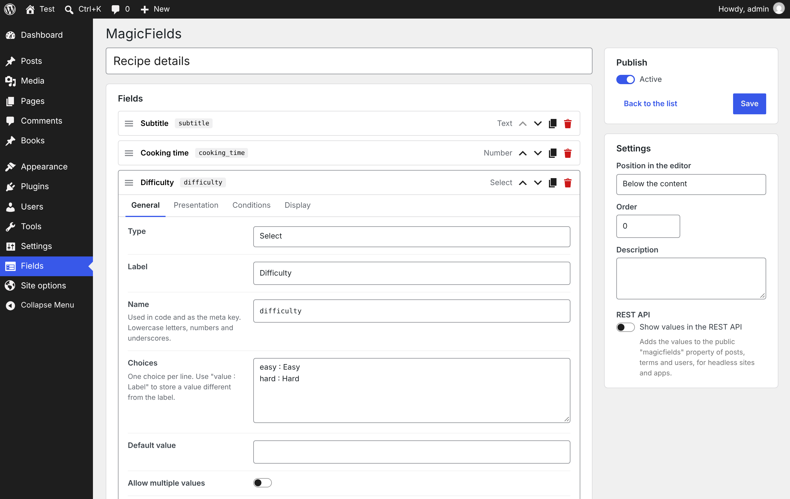
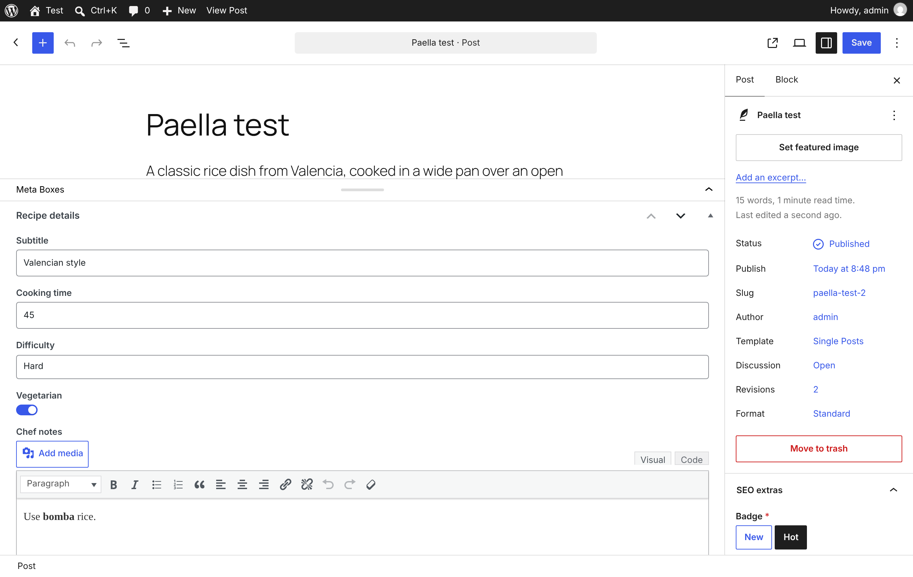
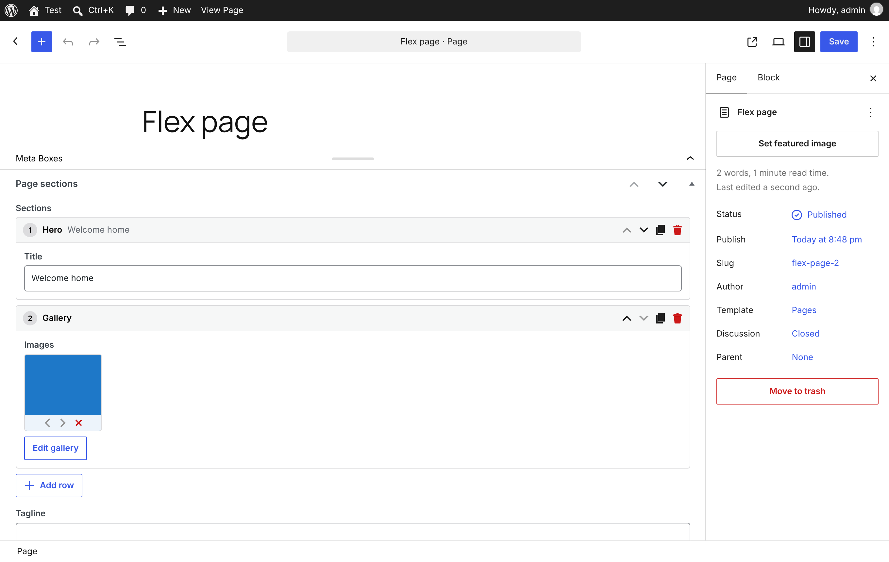
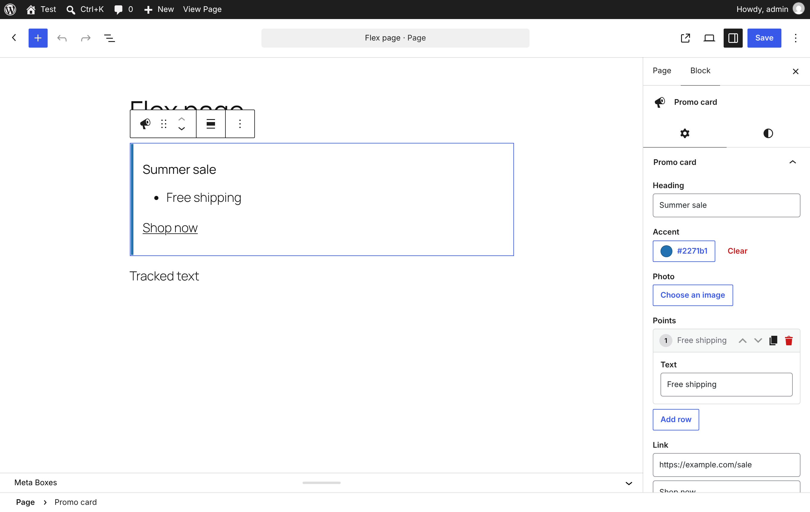

<h1 align="center">MagicFields</h1>

<p align="center">
  <strong>Des champs personnalisés pour WordPress, pensés pour l'éditeur de blocs.</strong><br>
  Une alternative libre et gratuite à ACF : créez vos groupes de champs visuellement, affichez-les partout, sans écrire de PHP.
</p>

<p align="center">
  <a href="README.md">🇬🇧 Read in English</a> ·
  <a href="#installation">Installation</a> ·
  <a href="#afficher-les-valeurs">Afficher les valeurs</a> ·
  <a href="#vous-venez-dacf">Vous venez d'ACF</a>
</p>

<p align="center">
  
  
  
  
</p>



*Les captures montrent l'interface en anglais ; l'extension est entièrement traduite en français.*

## Pourquoi MagicFields

- **Natif dans l'éditeur de blocs.** Les valeurs sont enregistrées avec le contenu, en une seule requête : annuler, « modifications non enregistrées » et brouillons se comportent normalement.
- **Affichage sans code.** Un bloc « Valeur de champ », la liaison de blocs pour Paragraphe, Titre, Bouton et Image, et un code court.
- **Des champs qui deviennent des blocs.** Transformez un groupe de champs en bloc à part entière avec un modèle HTML. Ni PHP, ni outil de build.
- **Remplace ACF sans casse.** Importez vos exports ACF : les contenus existants sont lus tels quels et `get_field()` continue de fonctionner dans votre thème.
- **Léger et transparent.** Moins de 100 Ko zippé, aucune étape de build, aucun service externe, aucun pistage, aucune version payante.
- **Français et anglais** inclus.

## Fonctionnalités

| | |
|---|---|
| **30 types de champs** | Texte, zone de texte, nombre, curseur, e-mail, URL, mot de passe, texte enrichi, image, fichier, galerie, lien, liste déroulante, cases à cocher, boutons radio, groupe de boutons, interrupteur, date, date et heure, heure, couleur, contenu, terme, utilisateur, répéteur, contenu flexible, groupe, clone, onglet, message |
| **Emplacements** | Types de contenu, modèles de page, un contenu précis, termes de taxonomie, utilisateurs par rôle, pages d'options, blocs. Règles combinables en *et* / *ou* |
| **Constructeur** | Glisser-déposer, sous-champs imbriqués, largeur des champs, champs obligatoires, logique conditionnelle, duplication, activation / désactivation |
| **Éditeur** | Champs sous le contenu ou dans la barre latérale |
| **Blocs** | Un groupe peut devenir un bloc, ou ajouter des champs aux blocs existants |
| **Pages d'options** | Valeurs communes à tout le site, créées depuis l'admin ou en PHP |
| **API REST** | Publication des valeurs activable groupe par groupe, pour les sites headless |
| **Import / export** | JSON, y compris les exports ACF |

### Dans l'éditeur

Les champs s'affichent sous le contenu ou dans la barre latérale, et s'enregistrent avec le contenu.



### Contenu flexible

Le rédacteur compose sa page avec les types de lignes que vous avez définis, chacun avec ses propres champs.



### Un groupe de champs utilisé comme bloc

Les champs se remplissent dans les réglages du bloc ; l'aperçu suit.



## Installation

1. Téléchargez le dépôt en ZIP (**Code → Download ZIP**), ou générez une archive propre avec `bin/build.sh` (crée `dist/magicfields.zip`).
2. Dans WordPress : **Extensions → Ajouter → Téléverser une extension**, puis activez.
3. Ouvrez **Champs** dans le menu d'administration et créez votre premier groupe.

Nécessite WordPress 6.5 ou plus récent et PHP 7.4 ou plus récent. Testé sur WordPress 6.5 et 7.1 avec PHP 8.3.

## Afficher les valeurs

### Sans code

- **Bloc « Valeur de champ »** : insérez-le et choisissez un champ.
- **Liaison de blocs** : reliez un Paragraphe, un Titre, un Bouton ou une Image à un champ depuis le panneau Attributs du bloc.
- **Code court** : `[magicfield name="sous_titre"]`. En option : `post_id="12"` ou `source="option"`.

### En PHP

```php
<?php
// Valeur formatée : tableaux d'image, objets de contenu, booléens…
$prix = magicfields_get( 'prix' );
$logo = magicfields_get( 'logo', 'option' );   // page d'options
$icon = magicfields_get( 'icone', 'term_12' ); // ou un WP_Term
$bio  = magicfields_get( 'bio', 'user_3' );    // ou un WP_User

// HTML sûr, échappé selon le type de champ.
magicfields_the( 'sous_titre' );

// Répéteur : un tableau de lignes.
foreach ( magicfields_get( 'ingredients' ) as $ligne ) {
	echo esc_html( $ligne['nom'] . ' × ' . $ligne['quantite'] );
}

// Contenu flexible : chaque ligne porte le nom de sa disposition.
foreach ( magicfields_get( 'sections' ) as $ligne ) {
	if ( 'hero' === $ligne['acf_fc_layout'] ) {
		echo '<h1>' . esc_html( $ligne['titre'] ) . '</h1>';
	}
}
```

`magicfields_get( $nom, $objet, false )` renvoie la valeur telle qu'elle est enregistrée. `magicfields_update( $nom, $valeur, $objet )` en enregistre une.

## Des champs qui deviennent des blocs

Dans un groupe de champs, ouvrez **Bloc** et activez « Faire de ce groupe de champs un bloc ». Le bloc apparaît dans l'outil d'insertion. Ses valeurs sont enregistrées dans le bloc lui-même : il peut donc servir plusieurs fois sur une page.

Le HTML vient, dans cet ordre :

1. du filtre `magicfields_render_block` ;
2. d'un fichier du thème `magicfields-blocks/{nom-du-bloc}.php` (reçoit `$fields`, `$block`, `$group`) ;
3. du modèle saisi dans le constructeur ;
4. d'une simple liste des champs.

Le modèle du constructeur est du HTML avec des emplacements :

| Emplacement | Résultat |
|---|---|
| `{{nom}}` | Le champ en HTML sûr : le texte est échappé, une image devient ``, un lien devient `<a>` |
| `{{nom\|raw}}` | La valeur enregistrée, échappée pour un attribut. Les images et fichiers donnent leur URL |
| `{{#nom}}…{{/nom}}` | Se répète pour chaque ligne d'un répéteur ou d'un contenu flexible. Pour les autres champs, affiche le contenu si le champ est rempli |
| `{{^nom}}…{{/nom}}` | Affiche le contenu si le champ est vide |

```html
<div class="carte" style="border-color: {{couleur|raw}}">
	<h3>{{titre}}</h3>
	<ul>{{#points}}<li>{{texte}}</li>{{/points}}</ul>
	{{#lien}}<p>{{lien}}</p>{{/lien}}
</div>
```

## Des champs sur les blocs existants

Choisissez **Bloc** comme emplacement d'un groupe (un type de bloc, ou tous). Ses champs apparaissent dans les réglages de ce bloc et sont enregistrés dans l'attribut `magicfields` du bloc. Leur usage demande quelques lignes dans un thème ou une extension :

```php
add_filter( 'magicfields_block_output', function ( $html, $fields, $block ) {
	return empty( $fields['masquer_mobile'] ) ? $html : '<div class="masquer-mobile">' . $html . '</div>';
}, 10, 3 );

// Ou partout où vous avez un bloc sous la main :
$fields = magicfields_get_block_fields( $block );
```

## API REST

Activez « Afficher les valeurs dans l'API REST » dans les réglages d'un groupe. Ses valeurs formatées sont alors publiées sous `magicfields` sur les contenus, les termes et les utilisateurs :

```
GET /wp-json/wp/v2/posts/12?_fields=magicfields
```

Les champs mot de passe n'y figurent jamais. Les contenus, termes et utilisateurs liés sont renvoyés sous forme d'identifiants.

## Déclarer en PHP

```php
add_action( 'init', function () {
	magicfields_register_group( array(
		'key'      => 'group_evenement',
		'title'    => 'Événement',
		'location' => array( array( array( 'param' => 'post_type', 'operator' => '==', 'value' => 'evenement' ) ) ),
		'fields'   => array(
			array( 'label' => 'Date', 'name' => 'date_evenement', 'type' => 'date', 'required' => true ),
			array( 'label' => 'Lieu', 'name' => 'lieu_evenement', 'type' => 'text' ),
		),
	) );
}, 1 );

magicfields_add_options_page( array( 'title' => 'Options du site', 'slug' => 'site' ) );
```

Les groupes déclarés en PHP sont en lecture seule dans l'administration.

## Vous venez d'ACF

1. Dans ACF : **Outils → Exporter les groupes de champs** (JSON).
2. Dans MagicFields : **Champs → Import / Export**, chargez le fichier.
3. Lisez le rapport d'import, puis désactivez ACF.

Ce qui est repris :

- **Vos contenus.** Les valeurs utilisent les mêmes clés de métadonnées, et le format « à plat » qu'ACF écrit pour les répéteurs, groupes et contenus flexibles est lu tel quel.
- **Vos gabarits.** `get_field()`, `the_field()`, `update_field()`, `have_rows()`, `the_row()`, `get_sub_field()` et `get_row_layout()` sont fournis quand ACF n'est pas actif. Pour les désactiver : `add_filter( 'magicfields_acf_compat', '__return_false' )`.

Ce qui ne l'est pas :

- Les blocs ACF (leurs gabarits PHP) et quelques types de champs comme Google Map. Le rapport d'import liste tout ce qui a été ignoré.
- Un champ clone qui préfixait les noms de ses champs dans ACF garde ici les noms d'origine, sauf en affichage « Groupe ».

## Où sont les données

- **Groupes de champs** : un contenu de type `magicfields_group` chacun.
- **Valeurs** : une métadonnée par champ de premier niveau, du nom du champ. Répéteurs, groupes et contenus flexibles sont enregistrés en tableaux. Les pages d'options utilisent des options nommées `options_{nom}`.
- **Désinstaller** supprime les groupes de champs et conserve les valeurs.

## Hooks

| Hook | Rôle |
|---|---|
| `magicfields_capability` | Droit requis pour gérer les groupes de champs (par défaut `manage_options`) |
| `magicfields_value` | Filtre une valeur renvoyée par `magicfields_get()` |
| `magicfields_html` | Filtre le HTML renvoyé par `magicfields_the()`, le bloc et le code court |
| `magicfields_render_block` | Renvoie le HTML d'un bloc issu d'un groupe de champs |
| `magicfields_block_output` | Modifie le HTML d'un bloc à partir des champs qui lui sont attachés |
| `magicfields_saved` | Action déclenchée après l'enregistrement des valeurs |
| `magicfields_acf_compat` | Renvoyer false pour ne pas définir les fonctions au nom d'ACF |

## Limites connues

- Les champs obligatoires placés dans un bloc ne bloquent pas l'enregistrement.
- Deux groupes affichés sur le même contenu ne doivent pas réutiliser un nom de champ : ils partageraient la même valeur.

## Développement

Aucune étape de build : l'administration est en JavaScript simple, sur la copie de React fournie par WordPress.

```bash
php tests/integration.php /chemin/vers/wordpress
```

```bash
php bin/strings.php fr_FR
```

La première commande lance 111 tests d'intégration sur une installation WordPress où l'extension est active (utilisez un site de test : elle crée et supprime ses propres contenus). La seconde vérifie que la traduction est complète.

## Licence

GPL-2.0-or-later. Sans lien avec Advanced Custom Fields ni WP Engine.
