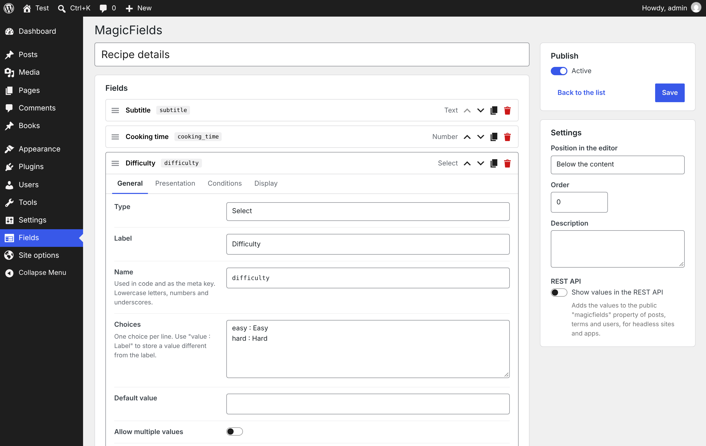
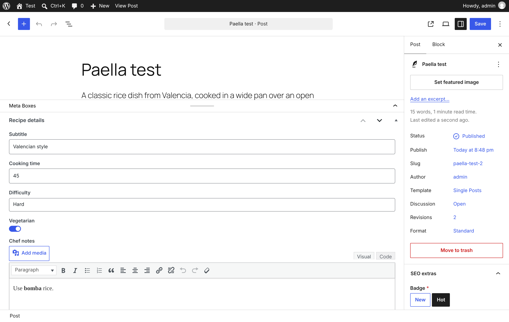
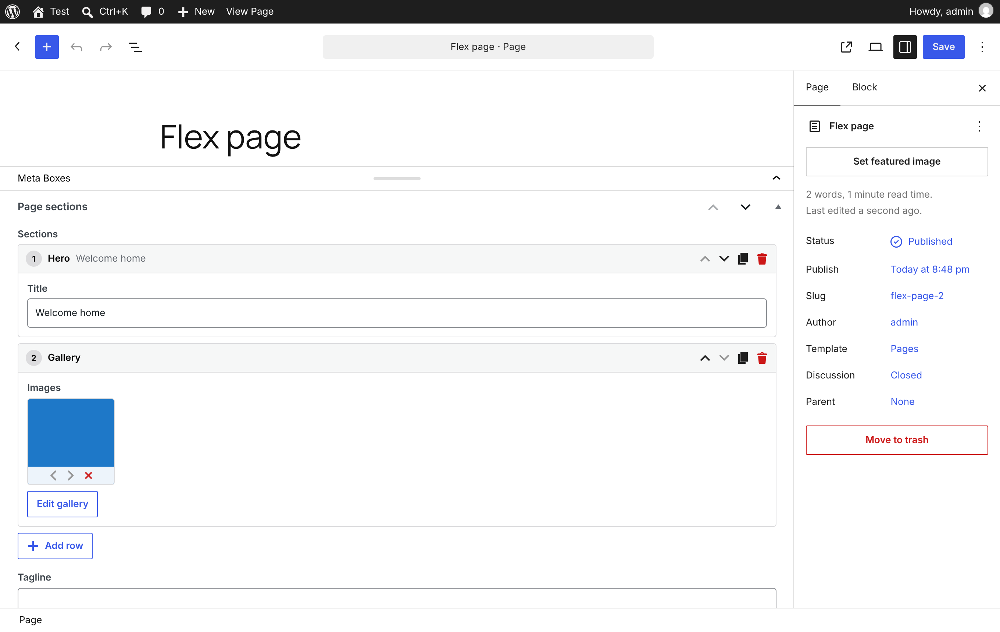
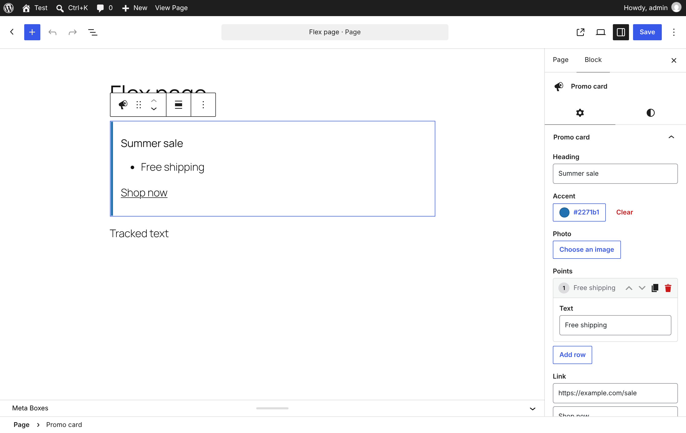

<h1 align="center">MagicFields</h1>

<p align="center">
  <strong>Custom fields for WordPress, built for the block editor.</strong><br>
  A free, open-source alternative to ACF: build field groups visually, show them anywhere, display them without writing PHP.
</p>

<p align="center">
  <a href="README.fr.md">🇫🇷 Lire en français</a> ·
  <a href="#install">Install</a> ·
  <a href="#display-values">Display values</a> ·
  <a href="#coming-from-acf">Coming from ACF</a>
</p>

<p align="center">
  
  
  
  
</p>



## Why MagicFields

- **Native to the block editor.** Field values are saved with the post in a single request, so undo, "unsaved changes" and autosave of drafts behave as they should.
- **Display without code.** A "Field value" block, block bindings for Paragraph, Heading, Button and Image, and a shortcode.
- **Fields as blocks.** Turn a field group into a block of its own with an HTML template. No PHP, no build tools.
- **Drop-in for ACF sites.** Import ACF exports; existing content is read as is, and `get_field()` keeps working in your theme.
- **Small and transparent.** Under 100 KB zipped, no build step, no external service, no tracking, no upsell.
- **English and French** out of the box.

## Features

| | |
|---|---|
| **30 field types** | Text, text area, number, range, email, URL, password, rich text, image, file, gallery, link, select, checkboxes, radio buttons, button group, toggle, date, date and time, time, color, post, term, user, repeater, flexible content, group, clone, tab, message |
| **Locations** | Post types, page templates, a specific post, taxonomy terms, users by role, options pages, blocks. Combine rules with *and* / *or* |
| **Builder** | Drag to reorder, nested sub fields, field widths, required fields, conditional logic, duplicate, activate / deactivate |
| **Editor** | Fields below the content or in the sidebar |
| **Blocks** | A group can be a block of its own, or add fields to existing blocks |
| **Options pages** | Site-wide values, created from the admin or in PHP |
| **REST API** | Opt in per group to publish values for headless sites |
| **Import / export** | JSON, including ACF exports |

### In the editor

Fields sit below the content or in the sidebar, and are saved with the post.



### Flexible content

Editors build a page from the row types you define, each with its own fields.



### A field group as a block

Fill the fields in the block settings; the preview follows.



## Install

1. Download the repository as a ZIP (**Code → Download ZIP**), or build a clean package with `bin/build.sh` (creates `dist/magicfields.zip`).
2. In WordPress: **Plugins → Add new → Upload plugin**, then activate.
3. Open **Fields** in the admin menu and add your first field group.

Requires WordPress 6.5 or later and PHP 7.4 or later. Tested on WordPress 6.5 and 7.1 with PHP 8.3.

## Display values

### Without code

- **Field value block**: insert it and pick a field.
- **Block bindings**: connect a Paragraph, Heading, Button or Image to a field from the block's Attributes panel.
- **Shortcode**: `[magicfield name="subtitle"]`. Optional: `post_id="12"` or `source="option"`.

### With PHP

```php
<?php
// Formatted value: image arrays, post objects, booleans…
$price = magicfields_get( 'price' );
$logo  = magicfields_get( 'logo', 'option' );   // options page
$icon  = magicfields_get( 'icon', 'term_12' );  // or a WP_Term
$bio   = magicfields_get( 'bio', 'user_3' );    // or a WP_User

// Safe HTML, escaped according to the field type.
magicfields_the( 'subtitle' );

// Repeater: an array of rows.
foreach ( magicfields_get( 'ingredients' ) as $row ) {
	echo esc_html( $row['item'] . ' × ' . $row['quantity'] );
}

// Flexible content: each row carries its layout name.
foreach ( magicfields_get( 'sections' ) as $row ) {
	if ( 'hero' === $row['acf_fc_layout'] ) {
		echo '<h1>' . esc_html( $row['title'] ) . '</h1>';
	}
}
```

`magicfields_get( $name, $object, false )` returns the value as stored. `magicfields_update( $name, $value, $object )` saves one.

## Fields as blocks

In a field group, open **Block** and turn on "Make this field group a block". The block appears in the inserter. Its values are stored in the block itself, so it can be used several times on a page.

The markup comes from, in this order:

1. the `magicfields_render_block` filter;
2. a theme file `magicfields-blocks/{block-name}.php` (receives `$fields`, `$block`, `$group`);
3. the template typed in the builder;
4. a plain list of the fields.

The builder template is HTML with placeholders:

| Placeholder | Result |
|---|---|
| `{{name}}` | The field as safe HTML: text is escaped, an image becomes ``, a link becomes `<a>` |
| `{{name\|raw}}` | The stored value, escaped for an attribute. Images and files give their URL |
| `{{#name}}…{{/name}}` | Repeats for each row of a repeater or flexible content. For other fields, shows the content when the field is filled |
| `{{^name}}…{{/name}}` | Shows the content when the field is empty |

```html
<div class="card" style="border-color: {{accent|raw}}">
	<h3>{{heading}}</h3>
	<ul>{{#points}}<li>{{text}}</li>{{/points}}</ul>
	{{#link}}<p>{{link}}</p>{{/link}}
</div>
```

## Fields on blocks

Set a group's location to **Block** (one block type, or all). Its fields appear in that block's settings and are stored in the block attribute `magicfields`. Using them takes a few lines in a theme or plugin:

```php
add_filter( 'magicfields_block_output', function ( $html, $fields, $block ) {
	return empty( $fields['hide_on_mobile'] ) ? $html : '<div class="hide-on-mobile">' . $html . '</div>';
}, 10, 3 );

// Or anywhere you hold a block:
$fields = magicfields_get_block_fields( $block );
```

## REST API

Turn on "Show values in the REST API" in a group's settings. Its formatted values are then published under `magicfields` on posts, terms and users:

```
GET /wp-json/wp/v2/posts/12?_fields=magicfields
```

Password fields are never included. Related posts, terms and users are returned as IDs.

## Register in code

```php
add_action( 'init', function () {
	magicfields_register_group( array(
		'key'      => 'group_event',
		'title'    => 'Event',
		'location' => array( array( array( 'param' => 'post_type', 'operator' => '==', 'value' => 'event' ) ) ),
		'fields'   => array(
			array( 'label' => 'Date', 'name' => 'event_date', 'type' => 'date', 'required' => true ),
			array( 'label' => 'Place', 'name' => 'event_place', 'type' => 'text' ),
		),
	) );
}, 1 );

magicfields_add_options_page( array( 'title' => 'Site options', 'slug' => 'site' ) );
```

Groups registered in code are read-only in the admin.

## Coming from ACF

1. In ACF: **Tools → Export field groups** (JSON).
2. In MagicFields: **Fields → Import / Export**, load the file.
3. Read the import report, then deactivate ACF.

What carries over:

- **Your content.** Values use the same meta keys, and the flattened layout ACF writes for repeaters, groups and flexible content is read as is.
- **Your templates.** `get_field()`, `the_field()`, `update_field()`, `have_rows()`, `the_row()`, `get_sub_field()` and `get_row_layout()` are provided when ACF is not active. Turn them off with `add_filter( 'magicfields_acf_compat', '__return_false' )`.

What does not:

- ACF blocks (their PHP templates) and a few field types such as Google Map. The import report lists everything that was skipped.
- A clone field that prefixed its field names in ACF keeps the cloned fields' own names, unless its display is "Group".

## Where data lives

- **Field groups**: one `magicfields_group` post each.
- **Values**: one meta entry per top-level field, named after the field. Repeaters, groups and flexible content are stored as arrays. Options pages use options named `options_{name}`.
- **Uninstalling** deletes the field groups and keeps the values.

## Hooks

| Hook | Purpose |
|---|---|
| `magicfields_capability` | Capability needed to manage field groups (default `manage_options`) |
| `magicfields_value` | Filter a value returned by `magicfields_get()` |
| `magicfields_html` | Filter the HTML returned by `magicfields_the()`, the block and the shortcode |
| `magicfields_render_block` | Return the markup of a field-group block |
| `magicfields_block_output` | Change a block's markup from the fields attached to it |
| `magicfields_saved` | Action fired after values are saved |
| `magicfields_acf_compat` | Return false to skip the ACF-style function names |

## Known limits

- Required fields inside blocks do not block saving.
- Two field groups shown on the same content should not reuse a field name: they would share one stored value.

## Development

There is no build step: the admin is plain JavaScript on top of the React copy that ships with WordPress.

```bash
php tests/integration.php /path/to/wordpress
```

```bash
php bin/strings.php fr_FR
```

The first runs 111 integration tests against a WordPress install where the plugin is active (use a test site: it creates and deletes its own content). The second checks translation coverage.

## License

GPL-2.0-or-later. Not affiliated with Advanced Custom Fields or WP Engine.
